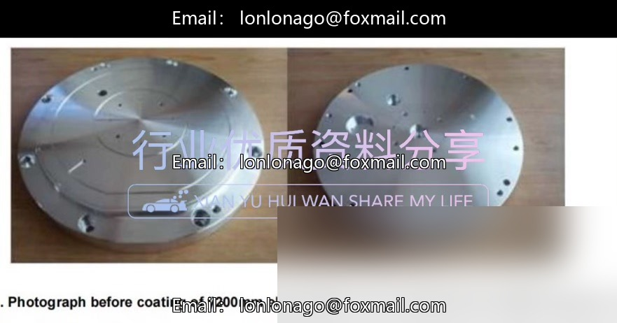
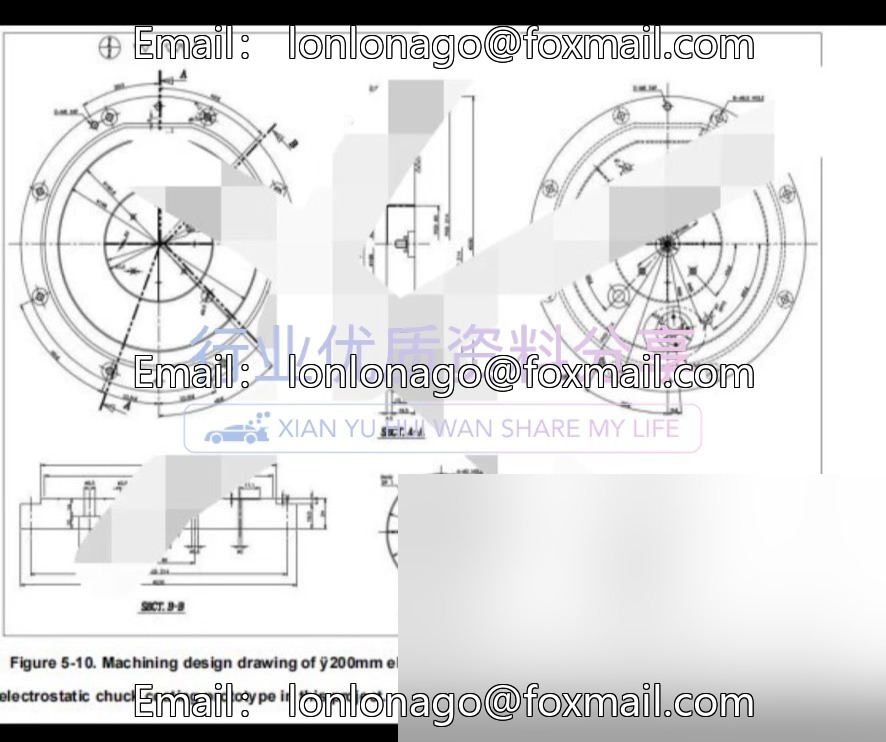
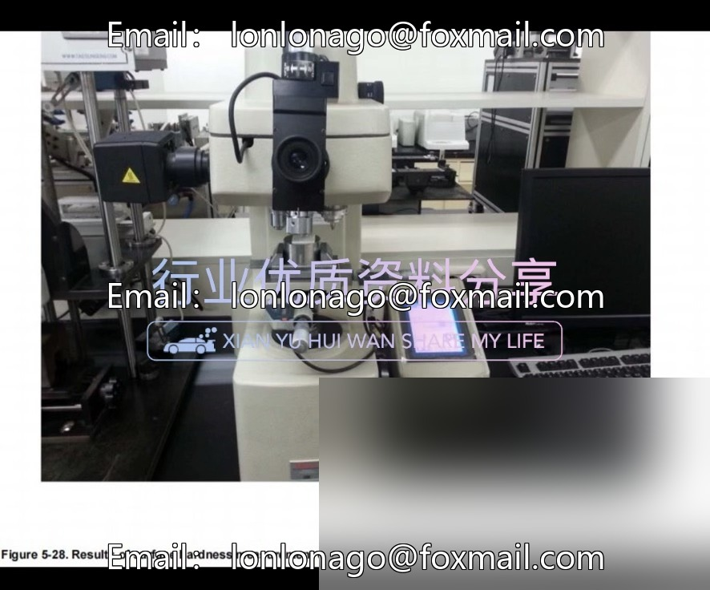
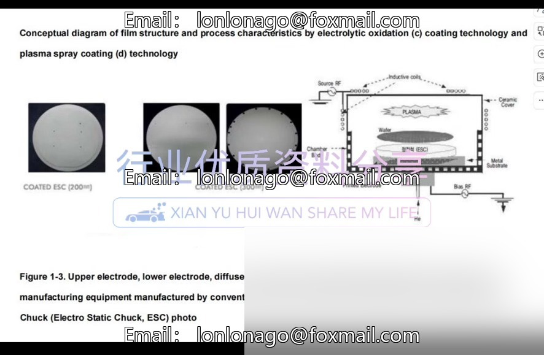
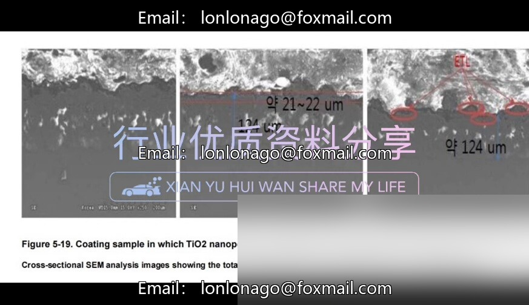
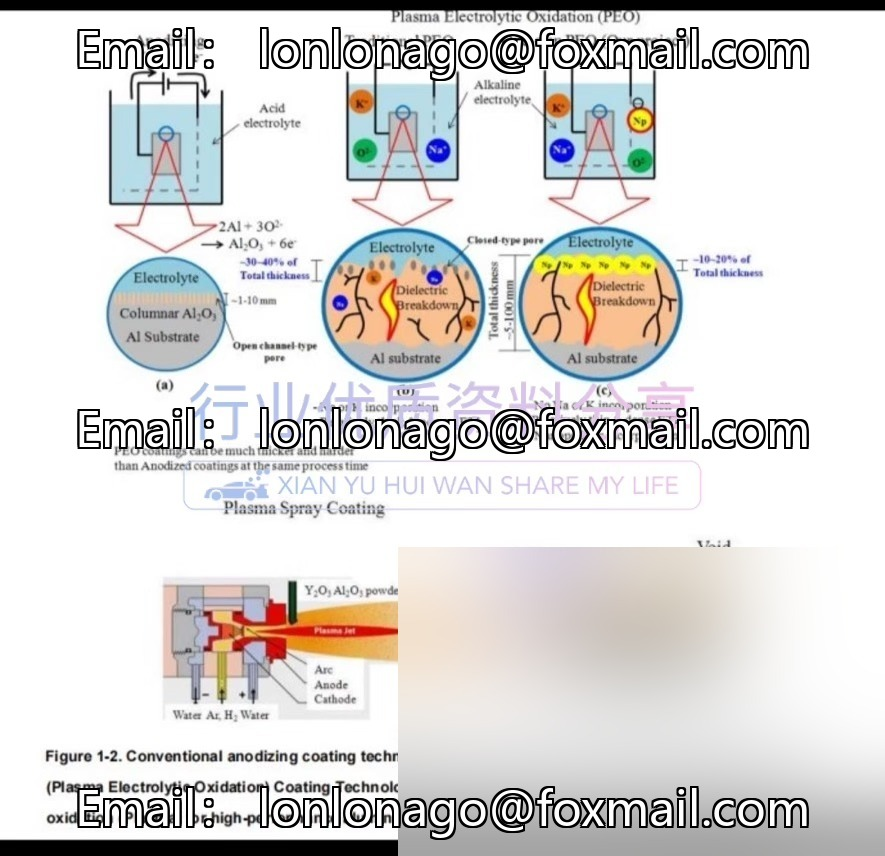

# Electrostatic chuck ESC-CHUCK coating technical data: for dry etching equipment!

## Body

Electrostatic chuck ESC-CHUCK coating technology data: for dry etching equipment! Development and research on eco-friendly coating technology of electrostatic suction discs   is very rich! This material was obtained through relations! For reference only!
Including research on the mechanism of coating and technical verification of coating measurement, as well as manufacturing processes, etc. Research deeply! Internal R&D materials of foreign enterprise! A complete 139-page PDF

Capture and send the electronic original directly! The following images include screenshots of the file portion. Please confirm before placing the order! Due to the replicable nature of electronic documentation Therefore, are allowed after purchase! Thanks for understanding!

For personal learning and reference use only.

The material covers electrostatic chuck ESC-CHUCK coating technology, including dry etching equipment, coating mechanism, measurement technology, manufacturing processes, and field photos of coating instances and results.

<!-- AI_ENRICHED -->

## Images

## Payment

Here is a pay link on Stripe ( https://buy.stripe.com/3cs8yP7sY87d0vu9AB ). Please contact me lonlonago@foxmail.com after funding $89, and I will send you a complete data files , thank you!

